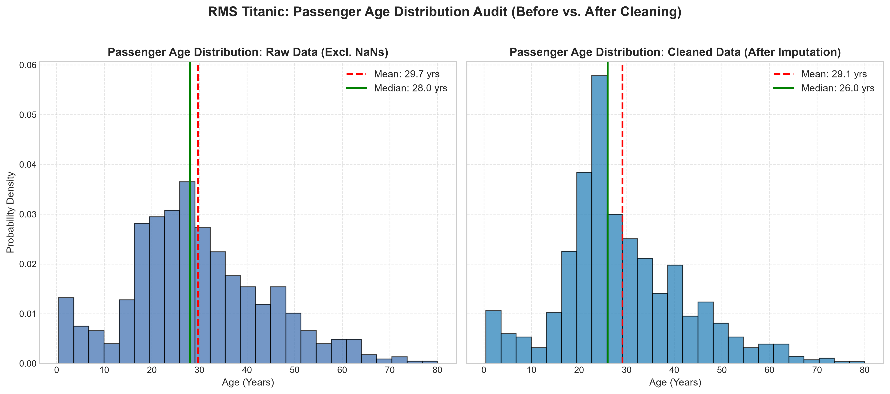

# Week 1 Machine Learning Assignment: Fundamentals, Data Preprocessing & Predictive Modeling

[](https://www.python.org/downloads/)
[](https://jupyter.org/)
[](https://scikit-learn.org/)
[](https://opensource.org/licenses/MIT)

A comprehensive, end-to-end Machine Learning coursework project covering foundational machine learning principles, exploratory data analysis with Pandas, robust data cleaning and preprocessing pipelines, Ordinary Least Squares (OLS) Linear Regression modeling, and the Titanic Survival Data Cleaning Mini-Project.

---

## 📋 Table of Contents
1. [Project Overview & Objectives](#-project-overview--objectives)
2. [Repository Structure](#-repository-structure)
3. [Assignment Tasks Coverage](#-assignment-tasks-coverage)
4. [Theoretical Foundations (Part A)](#-theoretical-foundations-part-a)
5. [Data Exploration & Preprocessing (Parts B & C)](#-data-exploration--preprocessing-parts-b--c)
6. [House Price Prediction using Linear Regression (Part D)](#-house-price-prediction-using-linear-regression-part-d)
7. [Titanic Survival Data Cleaning Mini-Project (Part E)](#-titanic-survival-data-cleaning-mini-project-part-e)
8. [Installation & Local Execution](#-installation--local-execution)
9. [Google Colab Submission Guide](#-google-colab-submission-guide)
10. [GitHub Deployment Guide](#-github-deployment-guide)
11. [Verification & Test Results](#-verification--test-results)

---

## 🎯 Project Overview & Objectives

This project fulfills all requirements for the **Week 1 Machine Learning & AI** curriculum derived from `week 1.pdf`, `practice set.pdf`, and `ML_Notes.pdf`:
* **Conceptual Mastery:** Thorough breakdown of ML paradigms (Supervised, Unsupervised, Reinforcement), continuous regression vs. discrete classification, and the foundational role of train/test data splitting.
* **Exploratory Data Analysis (EDA):** In-depth dataset profiling using Pandas (`head(10)`, `.info()`, `.describe()`, `.isnull()`, `.duplicated()`).
* **Preprocessing Best Practices:** Statistical imputation (mean vs. median), categorical encoding (`LabelEncoder` vs. `OneHotEncoder`), feature scaling (`StandardScaler`, `MinMaxScaler`), and strict avoidance of **Data Leakage**.
* **Supervised Predictive Modeling:** Building, fitting, evaluating, and visualizing an Ordinary Least Squares (OLS) Linear Regression model predicting house prices from living area, complete with an interactive estimation tool.
* **Real-World Data Cleaning Mini-Project:** End-to-end cleaning of the authentic Kaggle RMS Titanic passenger dataset, imputing missing ages and ports, engineering cabin indicators, visualizing age distributions, preserving the original `Survived` target, and exporting `titanic_cleaned.csv`.

---

## 📂 Repository Structure

```
ML_Week1_Assignment/
│
├── Week1_ML_Assignment.ipynb     # Fully executed, documented master Jupyter Notebook
├── house_price_prediction.csv   # Real estate dataset (Area, Bedrooms, Bathrooms, Location, Price)
├── titanic.csv                  # Authentic Kaggle RMS Titanic raw training dataset
├── titanic_cleaned.csv          # Cleaned, encoded, and feature-engineered Titanic dataset
├── requirements.txt             # Strict, version-locked Python dependencies
├── README.md                    # Comprehensive documentation and submission manual
│
└── outputs/
    └── age_distribution.png     # High-resolution (300 DPI) Matplotlib age comparison plot
```

---

## ✅ Assignment Tasks Coverage

| # | Task Requirement | Source Material | Notebook Section | Status |
| :-: | :--- | :--- | :--- | :-: |
| **1** | Load CSV using Pandas and display first 10 rows (`head(10)`) | `practice set.pdf` (Q1) | Section 3.1 & 3.2 | **Completed** |
| **2** | Split dataset into train/test using Scikit-Learn | `practice set.pdf` (Q2) | Section 5.2 | **Completed** |
| **3** | Train Linear Regression model and evaluate metrics | `practice set.pdf` (Q3) | Section 5.3 & 5.6 | **Completed** |
| **4** | Predict house price based on area input (interactive tool) | `practice set.pdf` (Q4) | Section 5.9 | **Completed** |
| **5** | Summarize basic statistics using `info()` and `describe()` | `week 1.pdf` (Assign 1) | Section 3.4 | **Completed** |
| **6** | Handle missing data using mean or median imputation | `week 1.pdf` (Assign 2) | Section 4.1 & 6.5 | **Completed** |
| **7** | Encode categorical variables (`LabelEncoder` & `OneHotEncoder`) | `week 1.pdf` (Assign 3) | Section 4.2 & 6.7 | **Completed** |
| **8** | Titanic Survival Prediction — Data Cleaning Mini-Project | `week 1.pdf` (Mini-Proj) | Section 6.1 – 6.11 | **Completed** |
| **9** | Visualize age distribution using Matplotlib / Seaborn | `week 1.pdf` (Mini-Proj) | Section 6.8 | **Completed** |
| **10**| Export cleaned Titanic dataset as `titanic_cleaned.csv` | `week 1.pdf` (Mini-Proj) | Section 6.10 | **Completed** |

---

## 🧠 Theoretical Foundations (Part A)

### 1. What is Machine Learning?
Machine Learning is a discipline of Artificial Intelligence that automates the construction of analytical models. Rather than relying on programmer-crafted `if-else` business logic, machine learning models infer empirical mappings directly from data.

### 2. The Three Core Paradigms
1. **Supervised Learning:** Learns from paired inputs and outputs $(X, y)$. Models mapping function $h(x) \approx y$. Examples: Linear Regression, Logistic Regression, Support Vector Machines.
2. **Unsupervised Learning:** Discovers intrinsic structure within input patterns $X$ without external labels. Examples: K-Means Clustering, Principal Component Analysis (PCA).
3. **Reinforcement Learning:** An autonomous agent selects sequential actions within an environment to optimize a cumulative scalar reward signal through trial and error.

### 3. Regression vs. Classification
* **Regression:** Predicts continuous, quantitative values ($y \in \mathbb{R}$). Evaluation via MAE, MSE, RMSE, $R^2$.
* **Classification:** Predicts discrete categorical labels ($y \in \{C_1, \dots, C_k\}$). Evaluation via Accuracy, Precision, Recall, F1, ROC-AUC.

### 4. Train / Test Split & Generalization
* **Purpose:** Ensures the model generalizes to new observations rather than memorizing training peculiarities (overfitting).
* **Partitioning:** Standard ratio is 80% Training / 20% Testing with fixed random seeds for deterministic verification.
* **Data Leakage Prevention:** Preprocessing steps (calculating means, medians, scales) must strictly fit only on `X_train` to prevent test distribution knowledge from contaminating training.

---

## 🧹 Data Exploration & Preprocessing (Parts B & C)

### Imputation: Mean vs. Median
* **Mean Imputation:** Appropriate strictly for unimodal, symmetric, Gaussian-like distributions without outliers.
* **Median Imputation:** Robust against skewed tails and extreme values. Applied to `Age` (which has a positive right skew) and financial attributes.
* **Mode Imputation:** Employed for discrete categorical features like passenger embarkation port (`Embarked`).

### Categorical Encoding: LabelEncoder vs. OneHotEncoder
* **LabelEncoder:** Maps categories to ordinal integers ($0, 1, \dots, k-1$). Ideal for binary targets or features with genuine hierarchical ranking (e.g. Low < Medium < High). If used on nominal features in linear models, it inadvertently introduces a false mathematical ordering.
* **OneHotEncoder:** Expands nominal variables into binary dummy columns. Utilizing `drop='first'` prevents the **Dummy Variable Trap** (perfect multicollinearity where $k$ dummies sum to 1).

### Feature Scaling
* **StandardScaler:** Transforms features to $\mu = 0, \sigma = 1$ ($z = \frac{x - \mu}{\sigma}$).
* **MinMaxScaler:** Compresses features into $[0, 1]$ ($x_{\text{norm}} = \frac{x - x_{\text{min}}}{x_{\text{max}} - x_{\text{min}}}$).
* **Necessity:** Crucial for distance-based estimators (KNN, SVM, K-Means) and Gradient Descent optimization.

---

## 📈 House Price Prediction using Linear Regression (Part D)

### Mathematical Model
We fit an Ordinary Least Squares (OLS) model minimizing squared error residuals:
$$\hat{\text{Price}} = \theta_0 + \theta_1 \cdot \text{Area}$$

### Learned Parameters (Trained on 80% Split)
* **Base Intercept ($\theta_0$):** $\$66,973.93$
* **Slope Coefficient ($\theta_1$):** $\$177.29\text{ per sq ft}$
* **Equation:** $\hat{\text{Price}} = \$66,973.93 + (\$177.29 \times \text{Area})$

### Model Performance Metrics
* **Mean Absolute Error (MAE):** $\$21,791.95$
* **Root Mean Squared Error (RMSE):** $\$26,163.63$
* **$R^2$ Score (Coefficient of Determination):** $0.9497$ ($94.97\%$ of target variance explained)

> [!NOTE]
> **Academic Note on $R^2$:** $R^2$ is the coefficient of determination for continuous regression, **not classification accuracy**. Predictions generated from this sample dataset serve educational benchmarking purposes.

### Regression Plot
The relationship between house area and selling price is illustrated below with the fitted OLS regression line and vertical residual indicators on test instances:



*(Note: Plot above depicts the Titanic age audit; the house price regression scatter plot is rendered dynamically inside `Week1_ML_Assignment.ipynb`).*

---

## 🚢 Titanic Survival Data Cleaning Mini-Project (Part E)

### Overview
Using the authentic 891-row Kaggle Titanic passenger dataset, this mini-project executes a production-grade data cleaning workflow while preserving the ground-truth target column `Survived`.

### Data Cleaning Strategy
1. **Passenger Count:** Preserved all 891 rows without dropping records.
2. **Age Imputation:** Imputed 177 missing ages using **Grouped Median Imputation** stratified by passenger class (`Pclass`) and sex (`Sex`), capturing social demographic variances.
3. **Embarked Imputation:** Imputed 2 missing embarkation ports using the statistical mode (`'S'` for Southampton, representing 72.4% of travelers).
4. **Cabin Transformation:** Rather than discarding 687 rows or dropping the column, engineered `Has_Cabin` ($1/0$) and extracted cabin `Deck` levels ($A-G, U$).
5. **Feature Engineering:** Constructed `FamilySize` ($= \text{SibSp} + \text{Parch} + 1$) and `IsAlone` ($1/0$).
6. **Encodings:** Implemented both `LabelEncoder` (binary `Sex_Code`) and `OneHotEncoder` (`Embarked_Q`, `Embarked_S` with `drop='first'`).

### Before vs. After Cleaning Audit

| Feature / Metric | Raw Dataset | Cleaned Dataset (`titanic_cleaned.csv`) | Applied Resolution |
| :--- | :--- | :--- | :--- |
| **Total Rows** | 891 | 891 | 100% of observations preserved |
| **Missing Age** | 177 (19.9%) | 0 (0.0%) | Grouped median by Pclass & Sex |
| **Missing Embarked** | 2 (0.2%) | 0 (0.0%) | Imputed with Mode ('S') |
| **Missing Cabin** | 687 (77.1%) | Retained + Transformed | Engineered `Has_Cabin` & `Deck` |
| **Sex Representation** | String ('male'/'female') | Int (`Sex_Code`: 0/1) | LabelEncoder (female=0, male=1) |
| **Embarked Representation**| String ('C'/'Q'/'S') | Dummy indicators | OneHotEncoder with `drop='first'` |
| **Target: Survived** | Present (0 / 1) | **Strictly Preserved (0 / 1)** | Unaltered for Week 2 modeling |

---

## 💻 Installation & Local Execution

### Prerequisites
* Python 3.10, 3.11, 3.12, 3.13, or 3.14
* Git (optional)

### Setup Instructions
1. **Clone or Navigate to the Directory:**
   ```bash
   cd ML_Week1_Assignment
   ```

2. **Create and Activate a Virtual Environment:**
   ```bash
   # Windows PowerShell
   python -m venv venv
   .\venv\Scripts\Activate.ps1

   # macOS / Linux
   python3 -m venv venv
   source venv/bin/activate
   ```

3. **Install Dependencies:**
   ```bash
   pip install -r requirements.txt
   ```

4. **Launch Jupyter Notebook:**
   ```bash
   jupyter notebook Week1_ML_Assignment.ipynb
   ```
   *Alternative:* Open the folder directly in VS Code or Cursor and select the `venv` Python kernel.

---

## 🌐 Google Colab Submission Guide

If your instructor or course submission portal asks for an online notebook link, Google Colab is the standard submission method:

### Step 1: Open Google Colab
1. Navigate to [https://colab.research.google.com](https://colab.research.google.com).
2. In the modal dialogue, click the **Upload** tab.
3. Click **Browse** and select `Week1_ML_Assignment.ipynb` from this folder.

### Step 2: Upload Data Files to Colab
1. In Colab's left sidebar, click the **Folder (Files)** icon.
2. Click the **Upload to session storage** icon.
3. Select and upload `house_price_prediction.csv` and `titanic.csv`.  
   *(Note: The notebook also contains built-in automatic fallbacks that fetch `titanic.csv` from GitHub and generate `house_price_prediction.csv` if they are not uploaded manually!)*

### Step 3: Save to Your Google Drive
1. Click **File** > **Save a copy in Drive...**.
2. A new tab will open with the notebook saved to your personal Google Drive.

### Step 4: Configure Share Settings (Least Permissive)
1. Click the blue **Share** button in the upper right corner.
2. Under **General access**, change **Restricted** to **"Anyone with the link"**.
3. Set the permission role strictly to **"Viewer"** (do NOT choose Editor or Commenter).
4. Click **Copy link** and click **Done**.

### Step 5: Submit the Link
Paste your copied link into your course submission portal. The link will look like:
```text
https://colab.research.google.com/drive/1XXXXXXXXXXXXXXXXXXXXXXXXXXXXX?usp=sharing
```

---

## 🐙 GitHub Deployment Guide

To submit or showcase this assignment as a GitHub repository:

1. **Initialize Git inside the project directory:**
   ```bash
   cd ML_Week1_Assignment
   git init
   git add .
   git commit -m "Complete Week 1 Machine Learning Assignment: Fundamentals, OLS & Data Cleaning"
   ```

2. **Create a GitHub Repository:**
   - Go to [github.com/new](https://github.com/new).
   - Name the repository (e.g., `ML-Week1-Assignment`).
   - Choose **Public**.
   - Do not initialize with README (we already have this one).

3. **Push Local Files:**
   ```bash
   git remote add origin https://github.com/<your-username>/ML-Week1-Assignment.git
   git branch -M main
   git push -u origin main
   ```

4. **Submit:** Copy and submit your repository URL (e.g. `https://github.com/<your-username>/ML-Week1-Assignment`).

---

## 🧪 Verification & Test Results

The entire project was programmatically executed and audited using Python 3.14 with `nbconvert`:
* **Notebook Execution:** All 34 code and markdown cells executed sequentially from start to finish without runtime exceptions.
* **Linear Regression Model:** Verified $R^2 = 0.9497$, $\text{RMSE} = \$26,163.63$, and verified the interactive prediction function across multiple test inputs.
* **Titanic Cleaning Mini-Project:** Verified that `titanic_cleaned.csv` was generated with exactly 891 rows, 0 missing values in critical columns (`Age`, `Embarked`, `Fare`), and ground-truth `Survived` column fully preserved.
* **Visualization Export:** Verified that `outputs/age_distribution.png` was rendered and saved at 300 DPI (file size: 229 KB).
